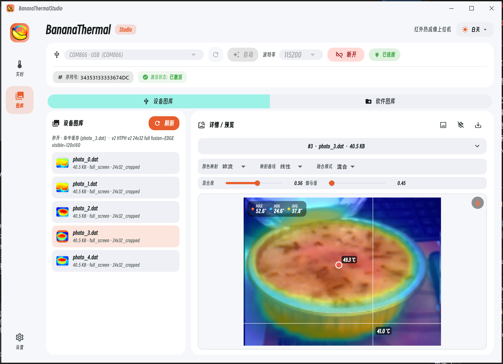
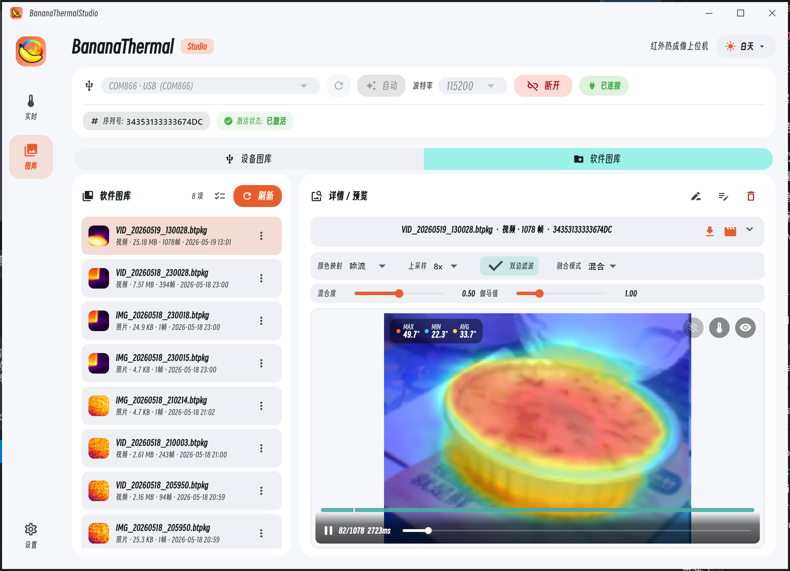

# 拍照、设备图库与软件图库

[上一章：按键与显示](02-controls-and-display.md) · [在线手册首页](README.md) · [下一章：Studio](04-studio.md)

## 设备本机拍照与相册

- 主画面短按 B：拍照并冻结当前画面；再次短按 B 退出冻结。
- 长按 B：进入设备内部相册。
- 相册中左/右：上一张/下一张；B：退出。
- 相册中第一次按 A 显示删除确认，第二次按 A 执行；任何其他键取消。
- 预览会使用照片中保存的热像缩放和偏移；旧照片缺失字段时按兼容默认值显示。

照片保存在 LittleFS，容量取决于 Flash 和固件分区。格式化前先下载；设备端删除和格式化都不可恢复。

## Studio 设备图库

1. 连接设备，进入“图库 → 设备图库”，点“刷新”获取列表。
2. 进入图库时 Studio 暂停实时流；离开后恢复进入前的推流状态。
3. 点照片进入下载队列。第一次完成后保存原始文件和缓存；同一会话再次打开优先使用内存缓存，跨会话可复用磁盘缓存。
4. 在详情页调整色板、曲线、融合、Gamma、边缘参数和测温标签。
5. 显示/隐藏可见光小窗与温度叠加；在元数据中查看照片格式、阵列/图像尺寸、拍摄参数和可用槽位。
6. 导出 PNG 会烘焙当前渲染效果、MAX/MIN/AVG 和点温标记。

刷新设备列表会清空当前会话状态，但不会删除磁盘缓存或设备照片。JPEG 设备照片按原始 JPEG/JPG 保存；没有温度矩阵的 JPEG 不能补做真实点温。Android 可把导出图写入系统相册。

> Studio 的设备图库用于下载、解析和导出；设备内部照片仍应在设备相册中二次确认删除。

## Studio 软件图库

实时页的拍照和录像保存为 Studio 本地 `.btpkg` 数据包。软件图库支持刷新、搜索/选择、重命名、备注、多选和永久删除。

| 操作 | 结果 |
| --- | --- |
| 打开照片 | 重渲染当前帧、显示/隐藏可见光与温度叠加、添加标签、导出 PNG |
| 播放视频 | 播放/暂停、拖动时间轴跳帧；末帧后再次播放从头开始 |
| 温度追踪 | 热点/冷点随帧重算；固定标签保持坐标、温度随帧采样 |
| 导出当前帧 | 只导出当前画面，不导出整段视频 |
| 导出 MP4 | Windows 使用随包 ffmpeg，Android 使用系统编码器 |
| 编码器不可用 | 回退为批量 PNG 帧，保留逐帧结果 |

### 动态槽位

每一帧独立记录热像和可见光槽位，因此同一段录像可以依次出现：

- 双路：热像 + 可见光；
- 纯热：只有温度矩阵；
- 纯可见：只有图像；
- 空帧：两路都关闭，仅有时间戳。

时间轴按每帧的 slot mask 还原实际内容。两路都关闭时拍照或录像会弹出确认；通常至少开启一路。回放中途缺少一路并不等于文件损坏。

## 保存位置与删除风险

- “设置 → 图库下载路径”决定设备图库 `raw/` 与 `exports/` 的根目录。
- 实时拍照和录像进入软件图库目录。
- 恢复 Studio 出厂设置不删除下载文件或 `.btpkg`。
- 软件图库删除 `.btpkg`、设备相册删除照片、设备格式化 LittleFS 均不可恢复。

格式细节见[协议与数据格式](06-data-formats.md)，实时拍摄和录制见[Studio 使用](04-studio.md)。
