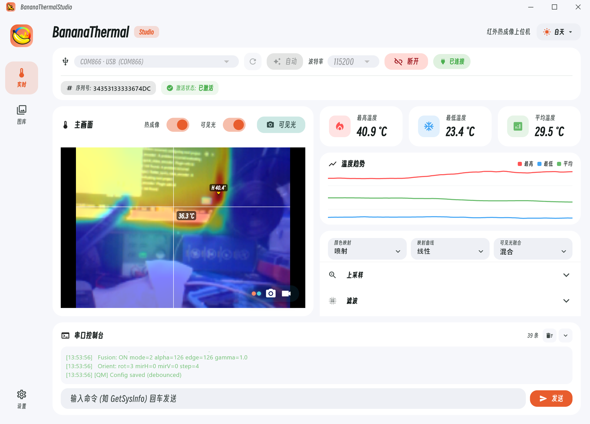

# BananaThermal Studio：连接、实时、历史与更新

[上一章：拍照与图库](03-capture-and-gallery.md) · [在线手册首页](README.md) · [下一章：高级设置](05-advanced-and-service.md)

BananaThermal Studio 支持 Windows x64 和 Android，可接收热像/可见光双路流、重渲染、测温记录、下载设备照片、管理 `.btpkg`、校准设备和检查软件更新。

## 安装与连接

| 平台 | 推荐包 | 安装要点 |
| --- | --- | --- |
| Windows x64 | `BananaThermal-windows-x64-setup.exe` | 运行安装器；便携 ZIP 必须完整解压后再运行 |
| Android | `BananaThermal-android.apk` | 允许安装未知来源应用；连接设备时授权 USB Host |

从 [NextBananaThermalStudio Releases](https://github.com/applenana/NextBananaThermalStudio/releases) 下载正式版。CI Artifacts 是测试构建，不适合日常稳定使用。

1. 用支持数据传输的 Type-C 线连接并打开设备。
2. 启动 Studio。Windows 自动扫描一次；Android 点“自动”并允许 USB 访问。
3. 波特率可选 `115200`、`230400`、`460800`、`921600`、`1000000`；默认先用 `115200`。
4. 自动失败时点“刷新”，手动选 COM/USB 端口，再点“连接”。
5. 看到绿色“已连接”、设备信息和激活状态后进入“实时”。

未激活时会显示遮罩：复制序列号，通过售后获取激活码后粘贴激活。不要在公开 Issue 中发布序列号或激活码。

### Android 界面行为

- 手机窄屏会使用单栏；平板/宽屏通常保留双栏。
- 系统返回键优先关闭弹窗、详情、侧栏或全屏，再返回上一页。
- 横屏全屏会进入沉浸模式；退出全屏后再断开设备。
- 自动连接需要系统 USB 权限；拒绝后需重新连接并授权。

## 实时双路画面

| 操作 | 怎么做 | 结果 |
| --- | --- | --- |
| 热成像推流 | 打开“热成像推流” | 接收温度矩阵，显示 MAX/MIN/AVG 和测温工具 |
| 可见光推流 | 打开“可见光推流” | 单独显示或参与融合；可与热流独立开关 |
| 单点 / 多点 | 选图标后点击画面 | 固定点温或放置多个标签 |
| 清理光标 | 点清理图标 | 清除当前单点、多点标记 |
| 全屏 | 点四角图标 | Windows 软件内全屏；Android 横屏沉浸 |
| 拍照 | 点相机 | 保存当前实际槽位为 `.btpkg` 照片 |
| 录像 | 点摄像机开始/停止 | 逐帧保存实际槽位，不中断实时显示 |

两路都关闭时拍照/录像只产生时间戳空帧，软件会要求确认。录制中可以开关任一路；每帧槽位动态记录。

### 可见光悬浮窗

双路推流时，可把可见光作为悬浮小窗放在热像之上。用开关显示/隐藏，拖动窗口移动，拖动边缘/角点调整尺寸。隐藏悬浮窗只改变显示，不会关闭可见光流，也不会从录像中删除可见光槽位。

## 渲染与融合

Studio 提供 11 套颜色映射：`jet`、`hot`、`inferno`、`magma`、`plasma`、`viridis`、`cividis`、`turbo`、`gray`、`cool`、`rainbow`，并支持线性/S 曲线。

- 上采样：最近、双线性、双三次；只改变显示平滑度。
- 滤波：双边、温度卡尔曼、像素卡尔曼、空间/亮度 σ；设备端与 Studio 不要同时设得过强。
- 融合：关闭、混合、边缘叠加及强度、阈值、粗细、Gamma。
- 显示：最高/最低追踪、温度图例方向、停靠、透明度和数字刻度。

这些 Studio 参数默认只影响本地显示/导出，不改变设备温度。先完成几何对齐，再调融合效果。

## 温度趋势与历史

收到热像帧后，Studio 可记录最高、最低、平均、固定单点、多个点和多点平均。普通视图与全屏视图共用同一会话。

- 频率：5 次/秒、2 次/秒、1 次/秒、每 2/5/10 秒一次；常规监测从 1 次/秒开始。
- 暂停只停止趋势记录，实时画面继续刷新。
- “保存并新建”归档当前会话，下一帧开始新会话。
- 历史页支持搜索、今天/7 天/30 天筛选、重命名、批量删除和 JSON 导入。
- 趋势图超长时界面最多等距绘制约 1200 点；CSV/JSON 仍保留全部记录。
- 导出可同时选择 CSV 原始数据、PNG 趋势图和 JSON 结构化数据。

## 设置与软件更新

设置页包括 DPI 0.8–1.6、主题、响应式断点、窗口尺寸（最小 600×400）、图库路径、更新、恢复出厂设置与关于。恢复设置不会删除已下载文件或 `.btpkg`。

更新流程会优先请求 GitHub 官方发布，在受限网络下尝试镜像，并验证文件大小与 SHA-256。可以忽略版本、稍后提醒、取消下载、失败重试或切换镜像。

- Android：校验 APK 后交给系统安装器；签名不同可能需要先备份并卸载旧版。
- Windows 安装版：启动 Setup 覆盖升级；应用仍运行时先退出。
- 便携 ZIP：退出应用，完整解压覆盖旧目录。
- 安装器窗口未出现时，可从下载完成页重新打开；只有一个镜像响应时会提示“未交叉验证”。

图库详见[拍照与图库](03-capture-and-gallery.md)，温度校准和控制台详见[高级设置与维护](05-advanced-and-service.md)。
