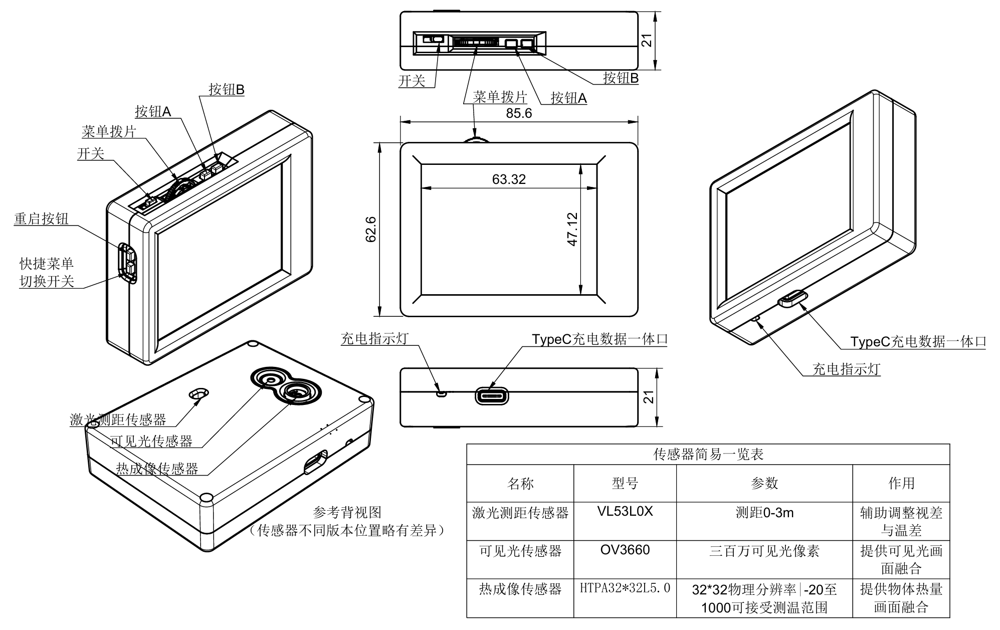

# 3.2 寸双光热成像在线使用手册

这是一份按“拿起设备就能用、遇到问题能定位、需要开发能查格式”组织的在线百科全书。内容覆盖当前公开固件 v1.7.0 与 BananaThermal Studio v0.4.2；不同传感器、摄像头、测距模块和外壳批次会自动增减部分功能。

## 推荐阅读路线

| 你是谁 | 从这里开始 |
| --- | --- |
| 第一次使用 | [认识设备与 5 分钟上手](01-device-tour.md) → [按键、触控与显示](02-controls-and-display.md) |
| 日常巡检 | [按键与快捷菜单](02-controls-and-display.md#按键在不同界面中的行为) → [拍照与图库](03-capture-and-gallery.md) |
| Studio 用户 | [安装、连接与实时画面](04-studio.md) → [设备/软件图库](03-capture-and-gallery.md) |
| 售后维护 | [高级设置与维护](05-advanced-and-service.md) → [故障排查](../TROUBLESHOOTING.md) |
| 上位机开发 | [协议与数据格式](06-data-formats.md) → [串口推流协议](../STREAMING_PROTOCOL.md) |

## 全部章节

1. [认识设备](01-device-tour.md)：部件、状态栏、传感器差异、第一次开机。
2. [按键、触控与显示](02-controls-and-display.md)：A/B/拨片/快捷键、手势、快捷菜单和 16 项详细菜单。
3. [拍照与图库](03-capture-and-gallery.md)：设备相册、设备图库、软件图库、缓存和导出。
4. [BananaThermal Studio](04-studio.md)：Windows/Android、USB、双路实时、趋势、拍照录像、更新。
5. [高级设置与维护](05-advanced-and-service.md)：双光对齐、测距视差、温度校准、UF2、控制台与坏点。
6. [协议与数据格式](06-data-formats.md)：实时帧、设备照片、`.btpkg` 与导出格式。

设备的 16 项菜单另有[逐项参数手册](../menu/README.md)，升级与故障处理分别见[安装与升级](../INSTALLATION.md)和[故障排查](../TROUBLESHOOTING.md)。

需要离线保存或打印时，可下载 [PDF 版](../../artifacts/BananaThermal_3.2寸双光热成像使用说明书_v1.7.pdf) 或 [Word 版](../../artifacts/BananaThermal_3.2寸双光热成像使用说明书_v1.7.docx)。

## 功能覆盖检查

| 功能域 | 已覆盖内容 |
| --- | --- |
| 硬件与输入 | 电源、Type-C、充电灯、复位、A/B、拨片/确认、快捷键、触摸与手势 |
| 本机显示 | 状态栏、全屏/方屏、7 套伪彩、图例、反色、亮度、滤波与测温光标 |
| 双光系统 | OV2640/OV3660、融合模式、缩放/X/Y、旋转镜像、VL53L0X、视差锚点 |
| 数据采集 | 本机拍照/相册、Studio 拍照/录像、动态热像/可见光槽位、趋势记录 |
| Studio | Windows/Android、连接与激活、11 色板、悬浮窗、图库、历史、校准、设置与更新 |
| 维护与发布 | 坏点修正、串口命令、UF2 三变体、校验签名、问题收集与安全边界 |
| 开发数据 | Thermal View v2、热像/可见光帧、设备照片格式、`.btpkg` v2、CSV/JSON/PNG/MP4 |

> 安全边界：本手册不公开激活算法、私钥、签名材料、生产测试流程或寄存器级危险写入。这些不是终端用户可安全操作的功能。

[返回项目首页](../../README.md) · [文档中心](../README.md) · [故障排查](../TROUBLESHOOTING.md)
