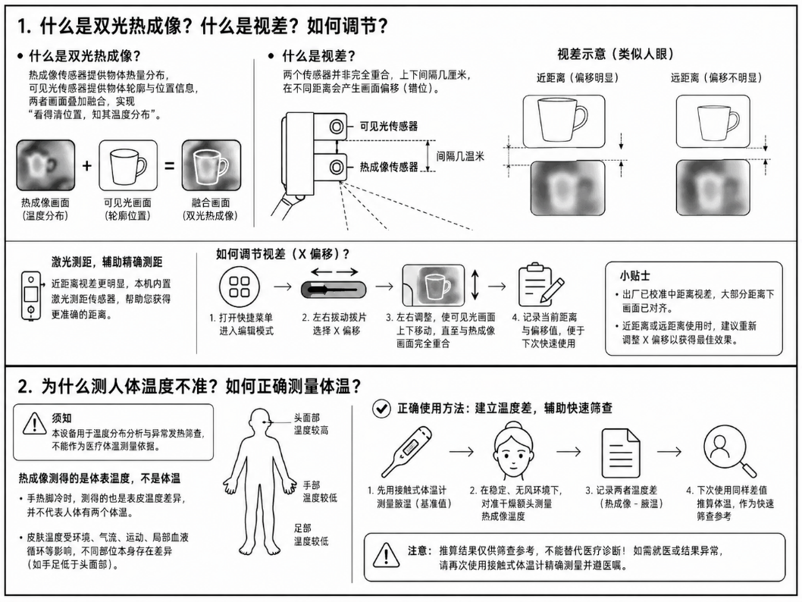

# Banana Thermal 双光热成像使用说明书

适用设备：3.2 寸双光融合热成像。文档版本：v1.8。更新日期：2026 年 10 月 19 日。

本手册覆盖双光设备日常操作、菜单设置、两路画面对齐、Studio 数据采集，以及统一固件的选择和升级。行为基线为统一固件 v1.8.0 对应源码及 Studio 0.5.5 源码；安装包是否可用以正式 Releases 为准。2.4、2.8、3.2 寸单光设备请阅读单光手册，其板型与本机不同。

## 1 认识双光设备

图示为双光外壳和某一传感器配置的示例。摄像头、热传感器型号及有效测量范围以实物和对应探头资料为准，不能把图中示例参数作为所有设备的量程或精度保证。

双光设备把热阵列的温度分布与可见光摄像头的轮廓放在同一画面。热像用于观察温差，可见光用于定位；两路传感器位置不同，近距离可能有视差。可见光融合不会增加热传感器的原生测温点。

| 部件 | 作用 |
| --- | --- |
| A 键 | 短按清理或隐藏测温标记；长按切换伪彩；相册删除确认 |
| B 键 | 短按拍照并冻结或退出；长按进入相册 |
| 菜单拨片 | 左右选择或调值；按下进入菜单和确认 |
| 独立快捷菜单键 | 打开或关闭快捷菜单，便于常用参数调整 |
| 复位键 | 立即重启；配合 A 进入 UF2 Bootloader |
| Type-C | 供电、充电与 USB 数据通信 |
| 热传感器与摄像头 | 分别采集温度和可见光；型号由设备自动检测 |
| 距离传感器 | 可选 VL53L0X，用于距离显示与自动视差 |

电源方向、复位入口和灯态以实物标记为准。3.2 寸外壳也可能是单光型号，不能仅按尺寸选择固件。

### 快速上手

1. 打开电源，等待热传感器与摄像头初始化。
2. 对准轮廓和温差都明显的目标，确认两路画面方向正确。
3. 长按 A 选择伪彩，按需要开启图例与最高温追踪。
4. 短按 B 拍照并冻结，再按返回；长按 B 进入相册。
5. 两路画面重影时按第 4 节对齐，不要只调整混合比例。
6. 使用数据线连接 Studio，分别测试热像和可见光推流。

## 2 按键 触摸与显示

| 输入 | 主画面 | 菜单 | 相册 |
| --- | --- | --- | --- |
| 左右拨片 | 减少或增加二次滤波；快捷菜单开启时选项或调值 | 选择与增减，长按连续调节 | 上一张或下一张 |
| 按下拨片 | 进入详细菜单；快捷菜单中切换浏览与编辑 | 进入、确认、结束编辑 | 删除提示中取消 |
| A 短按 | 清多点、隐藏主光标、隐藏冷热追踪、恢复 | 作为左键 | 第一次提示删除，第二次确认 |
| A 长按 | 切换伪彩 | 连续向左 | 保持相册操作 |
| B 短按 | 拍照并冻结，再按返回 | 作为右键 | 退出；删除提示中先取消 |
| B 长按 | 进入相册 | 连续向右 | 下一张 |
| A+B | 等同按下确认，触发后松开两键 | 等同确认 | 删除提示中取消 |
| 快捷菜单键 | 打开或关闭快捷菜单 | 关闭快捷菜单时保存 | 无主要操作 |

参数编辑完成后，在栏目“返回”处确认保存，再退出总菜单。快捷菜单通常在修改停止约 3 秒后自动保存；退出快捷菜单也会保存。

### 快捷菜单

按独立快捷键开启，用左右拨片选项，按下拨片进入编辑，左右调值，再按下结束编辑。常用项目包括全屏、亮度、色板、可见光缩放、视差模式、自动基准、可见光 X/Y、热像缩放与 X/Y、融合模式、比例、Gamma 和边缘颜色。没有距离传感器时相关视差项目隐藏；摄像头不可用时相关值可能显示 N/A。

### 触摸和图例

触摸硬件可用并启用后，可放置手动点温、多点标记和拖动图例。手势启用后下滑进入菜单、上滑退出、左右滑等同左右键、菜单中点击确认。图例拖动优先于滑动手势。触摸不准时用实体键进入触屏校准，再检查四角与中心。

### 全屏 方屏与真实分辨率

| 传感器 | 原生阵列 | 全屏热流 | 方屏热流 |
| --- | --- | --- | --- |
| MLX90640 | 32×24 | 32×24 | 32×24 |
| MLX90641 | 16×12 | 上采样 32×24 | 上采样 32×24 |
| Heimann HTPA32x32 | 32×32 | 32×24 | 32×32 |

LCD 全屏显示区域为 320×240，方屏为 240×240；它们不是原生测温分辨率。全屏与方屏分别保存热像和可见光的缩放与偏移，两种模式应分别检查。双光热像默认旋转 180 度，已有保存设置可能不同。

## 3 设备菜单

基础菜单共有 15 个栏目，检测到 VL53L0X 后增加视差和距离两个栏目，最多 17 个。

| 栏目 | 设置内容 |
| --- | --- |
| 亮度 | 背光，详细菜单 0 至 256；快捷菜单最低为 5 |
| 卡尔曼滤波 | Q、R、每帧滤波次数；降低波动但过强会拖尾 |
| 发射率 | 按表面材料与测量条件设置 |
| 温度校准 | 曲线段数、温区、整体权重和偏置、恢复默认 |
| 硬盘管理 | LittleFS 使用情况与格式化 |
| 测温光标 | 单点、多点、冷热追踪、字号、文字背景 |
| 伪彩调整 | 当前与开机色板、图例位置、透明度和刻度 |
| 触屏调整 | 触摸开关、手势与校准 |
| 全屏调整 | 全屏与方屏 |
| 摄像头 | 分模式缩放与偏移、热像对齐、步长和时序 |
| 融合 | 开关与模式、比例、旋转镜像、Gamma、边缘效果 |
| 滤波设置 | 快速插值、空间滤波、最小显示温差 |
| 反色设置 | 屏幕极性、软件反色、RGB/BGR 色序 |
| 传感器设置 | 热像旋转与缩放、速率、MLX 速率或 Heimann Trim |
| 温度报警 | 高低温阈值、迟滞、延时、锁存、重复和解除 |
| 视差调整 | 仅测距成功时显示，按距离补偿两路偏移 |
| 距离传感器 | 仅测距成功时显示，读取距离与校准 |

伪彩、图例、缩放、融合和 Gamma 主要改变显示；发射率及设备温度校准会改变输出温度。设备端和 Studio 的同名显示设置独立保存，不能假定同步。详细范围和操作方法见在线菜单指南。

## 4 双光对齐与测距

### 基础对齐

1. 选择要校准的全屏或方屏模式，暂时关闭自动视差。
2. 取中等距离、轮廓清楚且温差明显的目标，固定设备。
3. 检查热像与可见光方向、旋转、镜像和红蓝色序。
4. 调可见光缩放，使两路目标大小接近。
5. 调可见光 X/Y 粗对齐，再小幅调整热像 X/Y。
6. 测试画面中心与边缘，保存；切换另一屏幕模式后单独重复。

### 距离与视差

VL53L0X 初始化成功后才提供距离与自动视差。先检查测距读数和偏移，再设置基础对齐与距离锚点。用近、中、远目标验证，不把超范围状态当成精确距离。

N/A 表示测距不可用，超过量程的提示也不是一个可用于标定的数值。没有距离模块时继续使用手动对齐。测距调整不能替代热像与摄像头的旋转、缩放和基础 X/Y 对齐。

### 融合效果

混合模式调两路比例，边缘模式把可见光轮廓叠在热像上，半采样模式在较低分辨率缓存中融合再放大。先完成几何对齐，再调 Gamma、阈值和颜色。比例过大或边缘过密会遮挡小热点，但不会提高真实测温精度。

## 5 测温 校准与报警

目标需覆盖多个热像素，测量时保持距离与角度稳定。发射率和环境反射影响温度，亮面金属尤其明显；必要时在目标允许条件下使用已知发射率的表面并等待热平衡。颜色代表相对温差，不对应固定温度，以数字与图例读数为准。

不能把摄氏温度直接除以发射率得到真实温度。人体皮肤表面温度不等于核心体温；高温测量应以具体探头有效范围和参考源为依据。

### 新版校准

新固件兼容单直线校准，并支持最多 128 段的连续分段曲线。设备菜单显示段数和温区，可调整体权重、偏置或恢复默认；Studio 向导负责采样、拟合、误差检查和写入。

先读取原参数与曲线，稳定测量条件，在多个温点采集参考数据，检查残差后写入，再用未参与拟合的温点验证。单直线 gain 范围为 0.5 至 1.5，offset 为 -100 至 100 摄氏度。若已有分段曲线，把整体权重改回 1、偏置改回 0 不会删除曲线；需要完全恢复时使用明确的恢复默认流程。

设备输出的温度已经应用设备校准，不应在 Studio 再无条件叠加同一校正。新校准不改写旧照片。

### 温度报警

报警提供总开关、高低温独立通道、阈值、迟滞、触发与解除延时、锁存、重复上报和解除。默认总开关与通道关闭，高温 60 摄氏度、低温 0 摄氏度、迟滞各 2 摄氏度、触发 500 ms、解除 1000 ms、重复上报 1000 ms。

先启用需要的通道，用可控温源验证触发和解除。锁存报警需明确解除；确认后通道保持已确认状态，直到温度至少回到一次迟滞恢复区才重新布防。报警可显示并经串口上报，不代表设备内置蜂鸣器；外部声光器件需要另行连接支持协议的控制器。

## 6 拍照与图库

短按 B 本机拍照并冻结，再按返回；长按 B 进入相册，拨片左右翻页。删除时 A 第一次提示、第二次确认，其他键先取消。LittleFS 照片、格式化和删除都要先备份。

Studio 的设备图库负责下载设备原始照片并导出 PNG。进入时暂停实时流，退出时恢复。下载后打开检查，再决定是否删除设备原件。

Studio 实时拍照和录像进入软件图库，以 `.btpkg` 保存。每帧记录实际热像和可见光槽位，录像中关闭一路不等于文件损坏。软件图库可回放、改色板、加温度标签、导出当前帧或 MP4。两路都关闭时可能只有时间戳，拍摄前应检查画面。

PNG、JPEG 和 MP4 便于分享；保留温度矩阵的原始照片或 `.btpkg` 便于重测温。普通 JPEG 不包含温度矩阵时无法补出真实点温。趋势记录可以导出 CSV、JSON 和图表 PNG。

## 7 Studio 连接与采集

截图用于定位功能，不同软件版本的按钮布局可能变化。使用支持数据传输的 USB 线，Windows 安装完整程序包；Android 需支持 USB Host 并允许 USB 权限。Studio 点自动连接，失败时刷新端口、手动选口，先用默认 115200 波特率。

连接后确认双光设备身份与激活状态，分别开启热像和可见光。热像帧包含温度数据，可做点温、多点、冷热追踪与趋势；可见光可独立显示或作为悬浮窗和融合输入。

Studio 的色板、插值、滤波、图例和融合设置影响本地显示与导出；与本机 LCD 设置分别管理。悬浮窗隐藏不等于关闭可见光传输。实时录像结束后在软件图库检查回放，长期温度记录使用历史会话和 CSV/JSON 导出。

设置页可管理主题、缩放、窗口、下载目录、校准和软件更新。固件升级工具按设备身份锁定 dual 板型，不能选择 standard。软件更新后重新连接，让 Studio 读取新的设备身份与 Thermal View。

## 8 固件选择与升级

| UF2 环境后缀 | 实际 Flash | LittleFS | CPU | 用途 |
| --- | --- | --- | --- | --- |
| dual_sketch3m_fs5m | 8 MB | 5 MB | 300 MHz | 默认性能版 |
| dual_sketch3m_fs5m_stable | 8 MB | 5 MB | 220 MHz | OV3660 时序与降频稳定版 |
| dual_sketch1m_fs1m | 2 MB | 1 MB | 300 MHz | 小容量设备 |

v1.8.0 起正式发布配置为两板型共六个 UF2，本机只选 dual 的三个。v1.7.x 的历史三个文件名没有 dual 前缀，不应套用新文件名猜测旧附件。

1. 下载照片，记录发射率、校准、触摸、两种屏幕的对齐和视差锚点。
2. 确认 dual 与实际 Flash，下载对应 UF2 和校验签名文件，完成校验。
3. 保持 USB 数据连接，按住 A/BOOTSEL，短按并松开复位；电脑出现 Bootloader 磁盘后松开 A。
4. 复制 UF2，等磁盘断开、设备重启和初始化完成，不要中途断电。
5. 检查版本与板型、传感器、热像方向、两种屏幕、摄像头、融合、可选测距、拍照及 Studio 投屏。
6. 对照备份核查参数。分区或格式变化可能使旧数据不可读，回退前先查版本兼容性。

首次旧单光迁移的存储重建规则不应套用为所有 dual 升级必然格式化。双光升级仍需完整备份，尤其是切换 2 MB 与 8 MB 分区时。

## 9 排障与维护

| 现象 | 优先检查 |
| --- | --- |
| 不启动或显示异常 | dual 与 Flash 是否匹配、校验、供电；8 MB 可测试 stable |
| 可见光竖纹或随机重启 | 8 MB stable、数据线、电源、摄像头时序；分别测试两路 |
| 融合重影 | 方向、镜像、缩放、X/Y、屏幕模式独立参数，再查视差 |
| 测距 N/A | 模块是否安装及初始化，不能靠菜单开启不存在的硬件 |
| 画面拖尾或闪动 | 时间滤波、空间滤波、最小显示温差和采集速率 |
| 温度整体异常 | 发射率、目标覆盖、环境反射和当前曲线 |
| 方屏投屏异常 | 更新 Studio，重新读取 thermal view，不沿用全屏尺寸 |
| 图库下载或录像失败 | USB 稳定性、空间、原文件、完整软件包和编码器 |

维护前先停止录像与下载。使用 GetSysInfo、thermal view、calibration get、filter show、badpix list 等只读命令记录状态；分段曲线用 Studio 或 calibration2 能力读取。一次只修改一个参数，回读、重启并复测。

格式化、clean、坏点清空和传感器 Trim 恢复属于有数据或校准影响的操作，执行前应保留原数据。Heimann Trim 恢复不是普通菜单恢复默认。反馈问题时提供型号、板型、Flash、版本、传感器、摄像头、测距配置、Studio 版本和复现步骤，移除序列号与激活信息。

## 10 资料入口

- [详细在线手册](README.md)
- [设备分类与单光说明书](../devices/README.md)
- [菜单逐项指南](../menu/README.md)
- [安装与升级](../INSTALLATION.md)
- [发布完整性与签名](../RELEASE_INTEGRITY.md)
- [协议与数据格式](06-data-formats.md)
- [离线说明书与历史版本](../../artifacts/README.md)
- [文档来源与维护](../DOCUMENTATION_MAINTENANCE.md)
