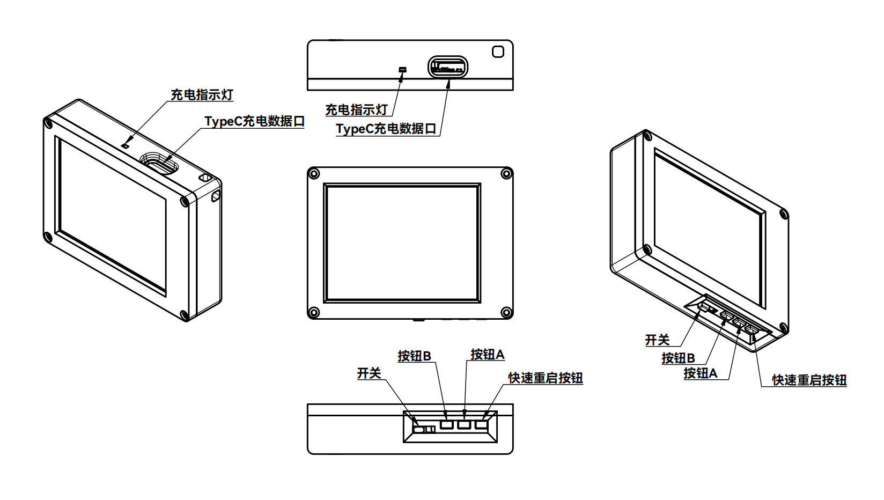
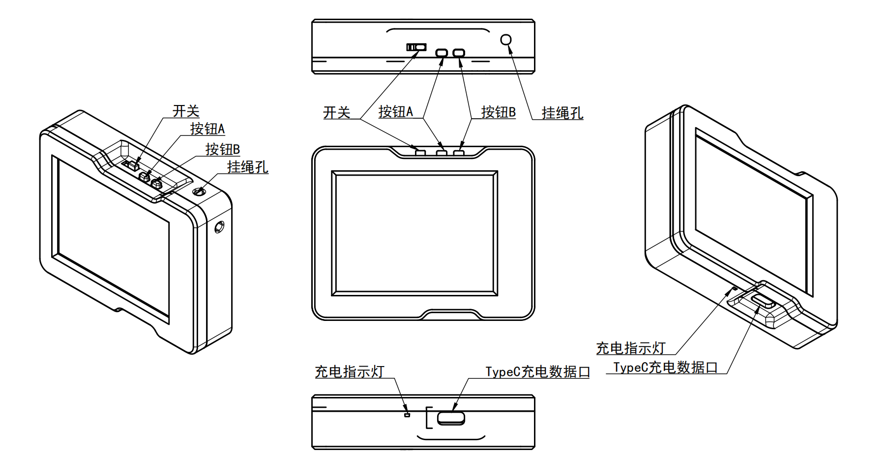
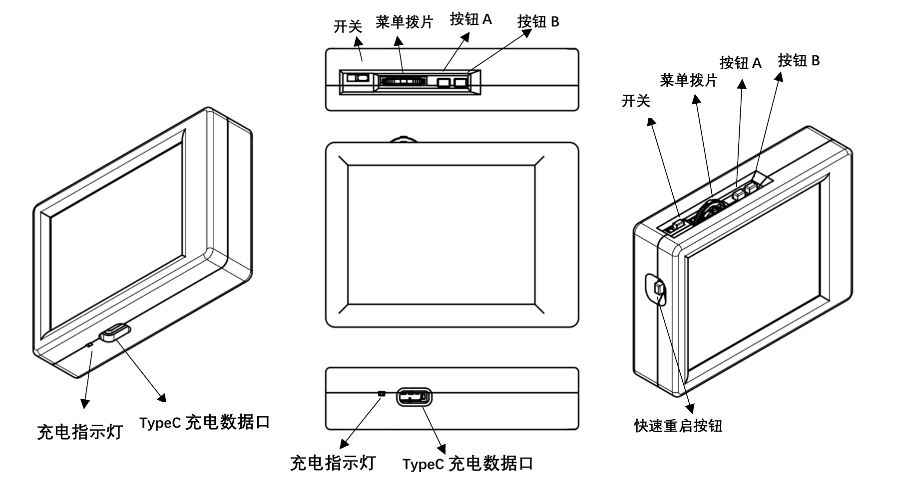

# Banana Thermal 单光热成像使用说明书

适用设备：2.4 寸、2.8 寸和 3.2 寸单光热成像。文档版本：v1.8。更新日期：2026 年 10 月 19 日。

本手册帮助你识别设备、完成日常测温与拍照、连接 BananaThermal Studio，并把旧单光固件迁移到统一固件。三种机型共用 `standard` 固件，操作差异主要来自按键和外壳；Flash 容量仍需单独确认。新版功能以统一固件 v1.8.0 对应实现和 Studio 0.5.5 源码为基线，下载时以正式 Release 为准。

## 1 使用前先确认

单光设备只有热成像通道，不含可见光摄像头、双光融合或激光测距。Studio 识别为单光后隐藏可见光和融合操作；本机若仍有“摄像头”“融合”栏目，进入后提示不可用是正常行为。

第一次从旧单光固件迁移时，会重建 LittleFS，清除设备照片、配置和校准。必须先导出重要照片并记录参数；旧分区能挂载且激活信息有效时，固件才尝试恢复激活。切换 2 MB 与 8 MB 分区可能需要重新激活。

日常使用先确认设备是单光、Flash 为 2 MB 或 8 MB、当前固件是旧版还是统一版。不能根据屏幕大小、传感器名称或下载文件大小推断 Flash 容量。

### 快速上手

1. 按外壳标记打开电源，等待传感器初始化完成。
2. 对准温差清楚的目标，保持目标覆盖多个热像素。
3. 在主画面长按 A 约 1 秒切换伪彩，短按 A 分层隐藏或恢复测温标记。
4. 短按 B 拍照并冻结，再短按 B 返回实时画面。
5. 长按 B 进入相册；重要照片通过 Studio 下载备份。
6. 需要设置参数时，3.2 寸按下菜单拨片；两键机在新固件中同时按 A+B，再松开两键。

## 2 三种机型的外观与差异

### 2.4 寸单光

本机以 A、B 两个功能键操作。原外壳图还标出了快速重启按钮；按实物确认其位置。旧资料记载向右开机、向左关机，以实物 ON/OFF 标记为准。Type-C 和充电灯位于图示侧面。

统一固件可用 A+B 进入菜单或确认，A 向左、B 向右。旧说明书没有介绍这套菜单操作，不能据此认为升级后仍只能拍照和换色板。

### 2.8 寸单光

本机以 A、B 两个功能键操作，原资料记载向右开机、向左关机。Type-C 与充电灯在另一侧，挂绳孔在图示位置。穿挂绳时不要用针、锥子等尖锐工具伸入孔内，以免损伤内部电池。

统一固件同样用 A+B 进入菜单或确认，A/B 选择与调值。旧资料没有明确标出本机独立复位键，刷机前应确认实物的 BOOT/RESET 入口；不要把挂绳孔当作复位孔。

### 3.2 寸单光

本机具有 A、B、三向菜单拨片和快速重启按钮。原资料记载向左开机、向右关机，与另外两款相反，以实物标记为准。拨片向下按为确认，左右拨动为选择或调值；单光机没有双光设备的独立快捷菜单键。

主画面左右拨动可减少或增加二次滤波强度；相册中左右拨动查看上一张或下一张。刷机可用 A 配合快速重启按钮，具体步骤见第 9 节。

### 操作差异速查

| 项目 | 2.4 寸单光 | 2.8 寸单光 | 3.2 寸单光 |
| --- | --- | --- | --- |
| 原资料开关方向 | 右开左关 | 右开左关 | 左开右关 |
| 实体菜单拨片 | 未列出 | 未列出 | 左右及按下确认 |
| 新固件菜单确认 | A+B | A+B | 按下拨片，也可 A+B |
| 相册翻页 | 长按 B 下一张 | 长按 B 下一张 | 左右拨片，也可长按 B 下一张 |
| 复位入口 | 原图有快速重启键 | 原资料未明确标出 | 原图有快速重启键 |
| 其他外壳说明 | 按图识别接口 | 有挂绳孔 | 不要与 3.2 寸双光混淆 |

## 3 按键与菜单

### 主画面和相册

| 操作 | 主画面 | 设备相册 |
| --- | --- | --- |
| A 短按 | 依次清多点、隐藏主光标、隐藏冷热追踪、恢复光标 | 第一次提示删除，第二次确认删除 |
| A 长按约 1 秒 | 循环伪彩 | 不作为换色操作使用 |
| B 短按 | 拍照并冻结，再按返回 | 退出；有删除提示时先取消提示 |
| B 长按约 1 秒 | 进入相册 | 下一张；需要再次长按时先松开 |
| A+B 同时按下再松开 | 统一固件中进入菜单 | 删除提示中取消；正常预览中可进入菜单 |
| 左右拨片 | 减少或增加二次滤波 | 上一张或下一张，仅有拨片机型 |

删除提示出现后，其他按键先用于取消删除；取消后再执行目标操作。照片删除不可恢复，建议先下载。

### 两键机怎样完成设置

1. 在实时画面同时按下 A+B，等菜单出现后把两键都松开。
2. 短按 A 向左选择，短按 B 向右选择；长按可连续移动。
3. 再按 A+B 进入栏目，选择参数后再按 A+B 进入编辑。
4. 用 A 减小、B 增大或切换；再按 A+B 结束编辑。
5. 移到栏目内“返回”并确认，保存设置；最后在总菜单“退出菜单”处确认。

组合键每次触发后需完全松开。菜单开启期间 A/B 优先作为左右键，短按 B 不再拍照，长按 A 不再换色。3.2 寸拨片完成同样的左、右、确认操作。

### 触摸与手势

仅在实物安装触摸硬件并初始化成功时使用。点击可放置测温点，开启多点模式后最多保留 5 点；开启手势后下滑进菜单、上滑退出、左右滑对应选择、菜单中点击确认。图例支持拖动时优先处理图例，不会同时触发翻页。

触摸偏差大时用实体键进入“触屏调整”重新校准，依次点击目标点并检查中心和四角。没有触摸硬件的设备继续使用实体键即可。

## 4 显示与测温设置

### 温度数字与伪彩

伪彩表示当前温度范围内的相对分布，同一种颜色不对应固定摄氏温度。开启温度图例，并结合 MAX、MIN 和点温判断。不同色板、反色设置会改变冷热颜色关系，不能一概认为红色永远代表最高温。

新配置默认启用最高温追踪并显示温度，最低温追踪默认关闭；已有保存配置继续按保存值工作。手动测温、多点测温和冷热追踪是不同显示层，可用 A 分层清理。

### 常用菜单

| 栏目 | 用途与建议 |
| --- | --- |
| 亮度 | 调整背光；详细菜单范围 0 至 256，过低会难以看清 |
| 卡尔曼滤波 | 调 Q、R 和每帧滤波次数；平稳画面与移动拖尾之间折中 |
| 发射率 | 按材料表面设置，低发射率金属尤其容易受反射影响 |
| 温度校准 | 查看单直线或分段曲线，微调整体权重与偏置，必要时恢复默认 |
| 硬盘管理 | 查看 LittleFS；格式化会删除照片和配置 |
| 测温光标 | 单点、多点、最高最低追踪、字号与背景 |
| 伪彩调整 | 当前色板、开机色板、图例位置、透明度与刻度 |
| 触屏调整 | 触摸开关、手势和校准；需要实际触摸硬件 |
| 全屏调整 | 在 320×240 全屏与 240×240 方屏之间切换 |
| 摄像头与融合 | 单光不可用，栏目可能保留提示 |
| 滤波设置 | 快速插值、空间平滑和最小显示温差 |
| 反色设置 | 屏幕极性、软件反色、RGB/BGR 色序 |
| 传感器设置 | 热像方向、缩放、速率和传感器专用操作 |
| 温度报警 | 高低温阈值、迟滞、延时、锁存和解除 |

单光菜单不显示距离与视差项目，没有实体快捷菜单键。需要调亮度、热像缩放或滤波时，从详细菜单进入。所有菜单参数的扩展说明见在线文档的菜单索引。

### 不同传感器与默认方向

| 传感器 | 原生阵列 | 统一固件热流 | 单光首次应用默认 |
| --- | --- | --- | --- |
| MLX90640 | 32×24 | 32×24，768 个值 | 旋转 180 度，MLX 速率 32 Hz |
| MLX90641 | 16×12 | 上采样为 32×24，768 个值 | 旋转 180 度，MLX 速率 32 Hz |
| Heimann HTPA32x32 | 32×32 | 全屏 32×24；方屏 32×32 | 不旋转，Q 为 0.5，R 为 1.75 |

这些单光默认值在识别到对应传感器类别后按版本标记应用并保存，不会每次开机都覆盖手动设置。两类单光传感器均把每帧卡尔曼次数设为当前最大档。方向不符时在菜单中修改，再检查热像与实际移动方向是否一致。

MLX 的硬件速率不等于屏幕完整帧率。全屏与方屏分别保存缩放和偏移，切换后应分别检查。插值与放大不会增加原生测温点数。

## 5 怎样获得有意义的温度

先让设备和被测物体达到稳定状态，固定距离与角度，让目标覆盖多个热像素。表面反射、发射率、目标大小和温度范围会影响结果，滤波只能改善波动，不能修复测量条件。

亮面金属可能主要反射周围热源；在目标允许的条件下，可使用已知发射率的表面处理并等待热平衡，再与可靠参考温度比较。不要直接套用其他波段的金属发射率表。

不能用“实际温度等于测量温度除以发射率”换算摄氏温度。发射率补偿涉及辐射与环境反射，应在设备支持的发射率设置和校准流程中完成。旧资料中的该公式不适用。

### 温度校准

新固件支持兼容单直线和最多 128 段的连续分段校准。设备菜单显示曲线段数与温区，并提供整体权重、整体偏置和恢复默认；复杂曲线应交给 Studio 向导管理。

1. 记录原校准并确认发射率，使用稳定、均匀的参考目标。
2. 通过 Studio 读取设备能力与现有校准，按向导采集不同温点。
3. 检查覆盖温区、拟合残差及误差指标，确认后写入。
4. 用未参与拟合的温点复核，并重启确认保存。
5. 校准异常时先回读；需要恢复时使用向导或设备“恢复默认”。

单直线的兼容参数范围为 gain 0.5 至 1.5、offset -100 至 100 摄氏度。分段曲线与整体修正共同决定输出；只把整体权重改回 1、偏置改回 0，不代表删除了原分段曲线。新校准不改写旧照片中已保存的温度。

### 常见理解误区

温差很小时轮廓不明显是正常现象；单光没有可见光轮廓可以叠加。热图只能显示表面热分布，无法保证识别隐藏摄像头，更不能根据没有热点认定没有摄像头。人体皮肤表面温度也不等同于体温计测得的核心体温。

测量高温时先确认具体探头的有效量程、目标材质和参考源，不把软件可设置阈值当成硬件量程。不要用火焰、太阳或反光点代替校准源。

## 6 温度报警

统一固件提供高温和低温报警。先打开总开关，再按需要打开高温或低温通道，设置阈值、迟滞、触发延时和解除延时。锁存开启后，即使温度回到正常范围，也需要明确解除。确认解除后通道保持已确认状态，直到温度至少回到一次迟滞恢复区才重新布防。

默认总开关与两个通道均关闭。默认高温阈值 60 摄氏度、低温 0 摄氏度、迟滞各 2 摄氏度、触发延时 500 ms、解除延时 1000 ms、锁存关闭、重复上报间隔 1000 ms。请按实际用途启用并测试。

温度报警可在设备画面和串口上报；它不代表设备内置蜂鸣器，也不会自动增加外部声光器件。Studio 或外部控制器需要支持对应报警协议。先用可控温源测试触发、解除和断连后的行为。

## 7 拍照 备份与文件

本机短按 B 保存照片并冻结，长按 B 进入相册。两键机通过长按 B 向后浏览，3.2 寸可用左右拨片。A 连按两次确认删除；B 或其他键可先取消删除提示。

连接 Studio 后打开“图库 → 设备图库”，刷新列表，下载原始照片并导出 PNG。确认下载结果可正常打开后再删除设备照片。进入设备图库时软件会暂停实时流，退出时恢复之前状态。

Studio 实时页拍照和录像保存到软件图库，使用 `.btpkg` 数据包。单光只包含热像通道，不应期待可见光图。PNG 和 MP4 适合查看与分享，保留温度矩阵的原始文件才便于后续重着色和点温分析；普通 JPEG 不会自动拥有温度数据。

Flash 容量和 LittleFS 分区决定存储空间，照片数量还受格式和内容影响。不要使用固定可拍张数估算剩余容量。首次迁移、格式化和分区切换前都要单独备份。

## 8 连接 BananaThermal Studio

1. 从 NextBananaThermalStudio 正式 Releases 下载适用于 Windows 或 Android 的安装包。
2. 使用支持数据传输的 Type-C 线；Android 还需设备支持 USB Host 并授予 USB 权限。
3. 打开热成像，点击 Studio 自动连接；失败时刷新端口并手动连接，先用默认 115200 波特率。
4. 确认设备信息识别为普通或单光热成像，再打开热成像推流。
5. 根据需要使用单点、多点、最高最低追踪、趋势、拍照和录像。
6. 在历史中管理测温会话并导出 CSV、JSON 或趋势 PNG；在软件图库回放 `.btpkg`。

新版 Studio 识别单光后隐藏可见光、融合和相应悬浮窗控件。没有这些按钮不表示功能损坏。设备端色板与 Studio 色板是各自的显示设置；发射率和设备校准则会影响传来的温度数据。

固件升级页面会根据设备身份锁定 `standard` 板型；旧单光 v2.2 会显示迁移提示，它不是统一固件的 v2.2 发布分支。迁移期间允许在同一板型的容量配置中选择，仍应先核对真实 Flash 容量并备份。

## 9 固件选择与首次迁移

### 选择 UF2

| UF2 环境后缀 | 实际 Flash | LittleFS | CPU | 选择原则 |
| --- | --- | --- | --- | --- |
| standard_sketch3m_fs5m | 8 MB | 5 MB | 300 MHz | 8 MB 默认性能版 |
| standard_sketch3m_fs5m_stable | 8 MB | 5 MB | 220 MHz | 8 MB 降频稳定版 |
| standard_sketch1m_fs1m | 2 MB | 1 MB | 300 MHz | 2 MB 设备 |

文件名还包含版本号并以 `.uf2` 结尾。三种屏幕共用这套选择规则，不可刷 `dual`。单光首次迁移最低使用支持 standard 的统一 v1.8.0；不要刷仅支持双光的旧统一版本。

### 备份与刷写

1. 下载照片，记录发射率、温度校准、触摸校准、方向、滤波等重要设置，并保留售后激活资料。
2. 确认板型与 Flash；下载 UF2 及 SHA256SUMS、签名和允许签名者文件，按仓库完整性指南校验。
3. 有明确 A/BOOTSEL 和复位键的设备：保持 USB 数据连接，按住 A，短按并松开复位，等 Bootloader 磁盘出现后松开 A。
4. 没有明确复位键的设备：按实物 BOOT/电源设计进入 Bootloader，或使用 Studio 的受支持升级流程。旧 2.8 寸资料没有给出复位位置，应先向售后确认入口。
5. 将正确 UF2 复制到 Bootloader 磁盘，等复制完成、磁盘断开和设备重启；过程中不要断电。
6. 首次启动等待存储重建完成。检查版本、单光身份、传感器、热像方向、色板、拍照、相册与 Studio 投屏。
7. 重新配置发射率、校准和触摸；必要时由售后协助重新激活。照片和配置不会自动恢复。

不拆机短接未知焊盘。UF2 模式与设备平时的照片存储不是同一个磁盘用途。一般升级与回退规则见仓库安装指南，旧格式与新格式不能假定可直接互读。

## 10 供电 维护与排障

使用可靠的充电器和完好线缆，充电灯通常为充电时亮、充满后灭，以实物为准。正在保存照片、格式化、传输或刷机时保持稳定供电。保持镜头和接口清洁，避免挤压、进液和异物进入。

| 现象 | 检查与处理 |
| --- | --- |
| 刷后不开机或屏幕异常 | 核对 standard、Flash 容量、分区和校验结果；正确 8 MB 设备可尝试 stable |
| 画面倒转 | 检查传感器型号和热像旋转；单光 MLX 与 Heimann 默认方向不同 |
| 连接后没有可见光 | 单光正常无此通道，只开启热像 |
| 两键机无法调参数 | 确认已升级统一固件；A+B 同时按下，触发后两键完全松开 |
| 相册无法翻到上一张 | 两键机没有独立左右键；长按 B 下一张或在 Studio 浏览 |
| 温度或色彩闪动 | 检查最小显示温差、时间和空间滤波；MLX 必要时从 32 Hz 降到 16 或 8 Hz |
| 温度整体不对 | 查发射率、反射、距离和当前校准；不要直接除以发射率 |
| 电脑找不到串口 | 换数据线和 USB 口，关闭占用端口的软件，Android 检查 USB 权限 |
| 迁移后照片或校准消失 | 首次 standard 迁移会清空；从外部备份恢复，不能靠反复刷写找回 |
| 迁移后提示未激活 | 核对分区和迁移情况，凭保留的资料联系售后 |

反馈时提供设备屏幕尺寸、单光板型、Flash、完整固件版本、传感器型号、Studio 版本和最短复现步骤。日志中删除序列号、激活码及密钥。

## 11 资料入口

- [设备分类与功能对照](../devices/README.md)
- [设备菜单逐项说明](../menu/README.md)
- [安装与升级指南](../INSTALLATION.md)
- [发布完整性与签名](../RELEASE_INTEGRITY.md)
- [协议与数据格式](06-data-formats.md)
- [离线说明书与历史版本](../../artifacts/README.md)

原始外壳与按键资料来自 2025 年的三份单光说明书；新版行为由固件及 Studio 实现补充。对应来源、版本和维护方式见[文档维护说明](../DOCUMENTATION_MAINTENANCE.md)。
